# Boostline

**Free, open-source ECU logger, log viewer, road dyno and drag timer for BMW B38 / B48 / B58 / S58 / N63 / S63 engines.**

Boostline connects to your car over an ENET cable or an MHD / bootmod3 WiFi adapter. It shows live engine data, records logs, and turns your pulls into graphs, power and torque estimates, and acceleration times. All of this runs in one desktop app for Windows and macOS.

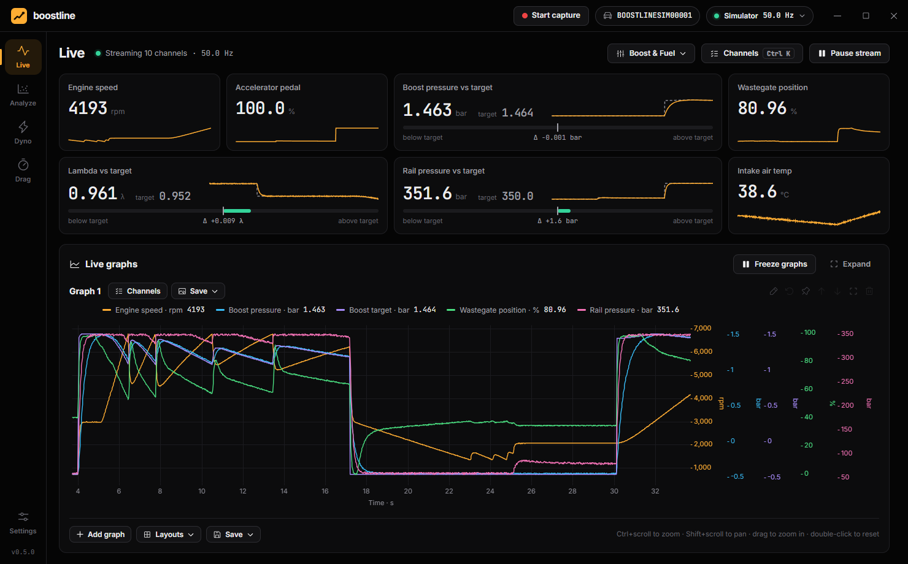

| Analyze: log library and WOT pull detection | Road dyno |
|---|---|
| 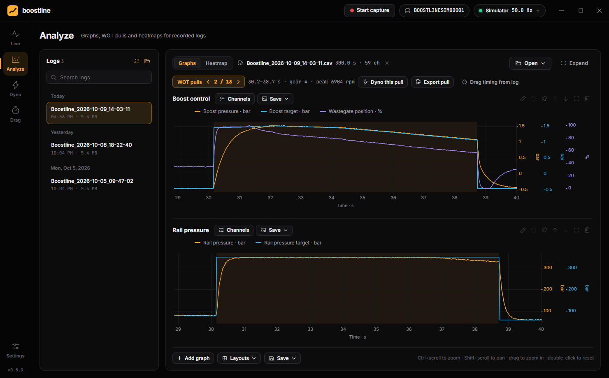 | 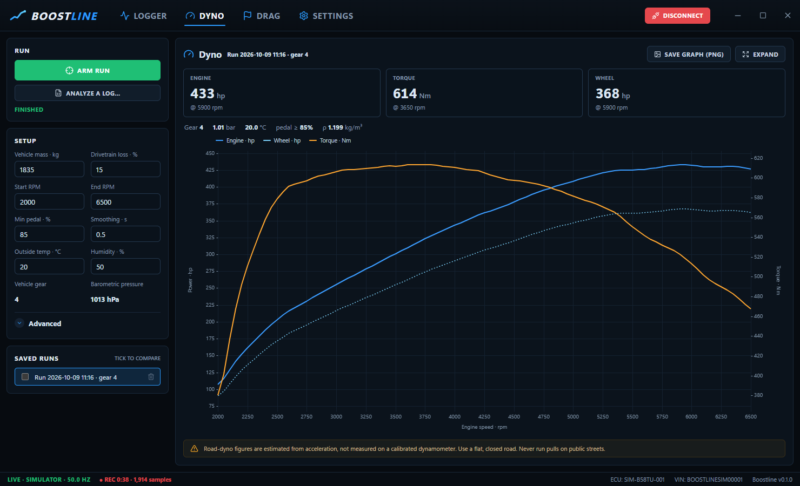 |

| Drag timing | |
|---|---|
| 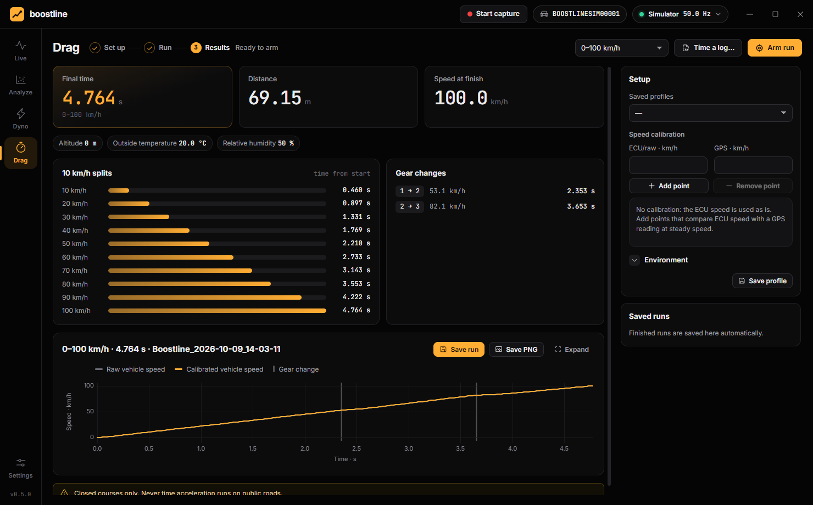 | Screenshots are from the built-in simulator. |

> Boostline is an independent community project. It is not affiliated with or endorsed by BMW, MHD or bootmod3 (proTuning Freaks). All trademarks belong to their owners.

---

## Features

### Live

- A dashboard of up to **40 channels**, each tile showing the current value and a 12-second sparkline.
- **Actual and target share a tile** (boost, lambda, rail pressure, throttle, wastegate, load, torque, VANOS), with a bar showing how far apart they are right now.
- **Ctrl+K** (⌘K on a Mac) opens a searchable channel picker. Channels are grouped: Engine, Throttle, Load, Boost, Fuel, Ignition, Knock, Temperatures, VANOS, Vehicle, Electrical.
- **Channel presets** you can save and load.
- **Live graphs** below the tiles plot incoming data. Freeze them to zoom into what just happened.
- **Start capture** in the top bar records to CSV from any screen. Optionally, a capture can start and stop automatically for each full-throttle (WOT) pull.
- Values display in your units: bar/psi/kPa, °C/°F, km/h/mph, Nm/lb-ft, hp/PS/kW, kg/h/g/s/lb/min, λ/AFR.

### Analyze

- A **log library** of everything you've recorded, grouped by day and searchable. Any other CSV log opens with **Open**.
- Up to **5 graphs × 5 channels**, each channel on its own colored Y axis.
- Navigation: Ctrl+scroll to zoom, Shift+scroll to pan, drag to zoom into a range, and double-click to reset. Cursors stay in sync across graphs.
- Cursor value pop-ups, manual scales per channel, and rename, pin, reorder, fullscreen and right-click actions per graph.
- **WOT pull detection**: jump from pull to pull, export a pull as CSV, or send it to the Dyno.
- **Compare two logs**: the second log is overlaid and automatically aligned on its first WOT pull.
- Opens Boostline, MHD, bootmod3 and generic CSV logs. The delimiter, decimal comma, units and time column are detected automatically.
- Save graph layouts, export the visible range to CSV, and save any graph as PNG.
- **Heatmaps (RPM × load)**: see where in the map timing gets pulled, the mixture runs lean, or boost misses its target, across one or many logs. See [Heatmaps](#heatmaps).

### Dyno (road dyno)

- **Arm** a run and do a single-gear full-throttle pull. Boostline detects the pull and the gear automatically.
- Estimates **engine power, wheel power and torque** vs. RPM from the car's acceleration.
- Accounts for vehicle mass, drivetrain loss, aero drag (Cd·A), rolling resistance, temperature, humidity and air pressure. Optional **SAE J1349 / DIN 70020** correction.
- Analyze any recorded log. Runs are saved automatically and can be overlaid for comparison.

### Drag

- **0–100, 100–200 and 200–300 km/h; 0–60 and 60–130 mph; 1/8 and 1/4 mile.**
- Standing starts wait for the car to stop, then time from first movement.
- A split for every 10 km/h (or mph), gear changes with time and speed, distance and trap speed.
- **GPS speed calibration**: enter ECU vs. GPS speed points to correct speedometer error. Shows raw vs. calibrated speed curves.
- Saved profiles store the calibration and environment (altitude, temperature, humidity).

### iPhone and iPad (in testing)

An iOS version with the same screens is in TestFlight testing (not on the App Store yet). It connects through the MHD and bootmod3 WiFi adapters. See [docs/ios.md](docs/ios.md).

### Simulator

A physics-based B58 drive cycle (launches, shifts, a 4th-gear pull, boost spool, knock events) lets you try every screen without a car.

---

## Hardware

| Interface | Status |
|---|---|
| **ENET cable** (F/G-series OBD to Ethernet) | Supported. On most Macs it needs a USB-C to Ethernet adapter. The car is found automatically via UDP discovery on port 6811, and diagnostics run over HSFZ on TCP 6801. |
| **MHD WiFi adapter** | **Confirmed working.** Join the adapter's **MHD ENET** WiFi network first. The adapter also broadcasts **MHD ECA**, which won't connect. |
| **bootmod3 WiFi adapter** | Supported via the adapter's ENET gateway. Join the adapter's WiFi first. |
| K+DCAN / ELM327 | Not yet. |

Both WiFi adapters are sold as working with E-Sys, ISTA and BimmerCode, all of which speak HSFZ. Boostline therefore treats them as ENET gateways at the adapter's IP. If your adapter isn't found, open **Settings → Connection → Run diagnostics**. It scans the network, tries discovery and a read-only VIN request, and saves a byte-level capture you can attach to an issue.

### Channels on a real car

Without any extra data, Boostline reads the **standard OBD-II channels** the DME exposes over UDS (`ReadDataByIdentifier` 0xF400–0xF4FF): RPM, speed, pedal, throttle, load, MAP and boost, MAF, timing advance, temperatures, lambda, fuel trims, rail pressure and torque.

For the full BMW channel set, import **BMW DME data** once in **Settings → BMW DME data** (step-by-step: [Setting up BMW DME data](#setting-up-bmw-dme-data)). That covers boost target, wastegate position, rail pressure actual and target, lambda actual and target, per-cylinder timing and knock, VANOS, air mass through throttle, driver wish torque, torque reserve and hundreds more.

- **Where it comes from:** every BMW DME's diagnostic description file (SGBD) has a table, `SG_FUNKTIONEN`, listing its live measurements with their UDS data identifiers, data types, scaling and units. The open-source [bmw-unified-db](https://github.com/gediz/bmw-unified-db) project has decoded these files.
- **Getting it:** Boostline downloads the latest release once (about 130 MB) and keeps only the engine-ECU tables (a few MB, in the app's data folder). You can also import a `bmw.sqlite` you already have.
- **Why it isn't bundled:** the data is BMW-copyrighted, so it isn't part of this repository or the installer.
- **Picking the right file:** on connect, Boostline reads the DME's diagnostic index (`22 F150`, the same request BMW's tools use to identify the DME) and selects the matching data automatically. You can also pick it manually.
- **Logging speed:** measurements are batched into dynamically defined data identifiers (`2C 01`), as BMW's own `STATUS_BLOCK_LESEN` job does, so many channels arrive in one request.

| Engine | Example cars | DME data |
|---|---|---|
| B58 (gen 1 and TU) | M140i, M240i, 340i / M340i, 440i / M440i, 540i, 740i, 840i, X3/X4 M40i, X5/X6/X7 40i, Z4 M40i, Supra 3.0 | `dme_bx8x`, `dme8ff_r` |
| B48 / B38 | 118i–330i, 420i/430i, 520i/530i, X1/X2/X3 20i–30i, Z4 20i/30i, Supra 2.0, MINI F5x, i8 | `dme_bx8x`, `dme8ff_r` |
| **S58** | G80/G81 M3, G82/G83 M4, G87 M2, F97 X3 M, F98 X4 M | `dme8ff_r` |
| **S55** | F80 M3, F82/F83 M4, F87 M2 Competition / CS | `s55` |
| N55 / N20 / N13 | F-series 35i, 28i and 16i–20i models, F87 M2 | `mevd172*`, `n55_alp`, `mevd1724`, `mevd1725` |
| N63 / S63 TU / N74 | 550i, 650i, 750i, X5/X6 50i, M5/M6, X5 M/X6 M, 760i | `msd85*`, `n63tu_*`, `s63tu_*`, `msd87_*`, `dme8ff_l/r` |

Notes:

- **Auto-detect gaps:** the B58 gen-1 files (`dme_bx80/81/82`) list no diagnostic index, so on those cars choose the DME data manually in Settings.
- **Not covered:** 2022+ cars on the newest DME generation, the S68, and E-series cars (they don't use ENET).
- **Verification:** coverage comes from the data and still needs confirming on real cars. Reports are welcome.

Anything not covered can still be added with [custom definition files](#custom-channel-definitions).

### Safety

Boostline only *reads* from the car. The UDS client enforces a hard allowlist of read-only services:

- `0x10` session control (default/extended)
- `0x22` read data by identifier
- `0x23` read memory by address
- `0x2C` dynamically define data identifier (a temporary RAM definition used for fast logging)
- `0x3E` tester present
- `0x19` read DTCs

It never codes, flashes, or clears anything.

**Only do WOT pulls and drag runs on a closed course.**

---

## Getting started

### Download

Download the latest version from the [Releases](https://github.com/clucraft/Boostline/releases) page:

| Platform | File |
|---|---|
| **Windows** 10/11 (x64) | `Boostline.Setup.<version>.exe` (installer), or `Boostline.<version>.exe` (portable, no install) |
| **macOS** 11 or later (Apple Silicon and Intel) | `Boostline-<version>-mac-universal.dmg`, then follow [Installing on macOS](#installing-on-macos) |

### Installing on macOS

Boostline is free and isn't signed by Apple (that costs $99 a year), so macOS blocks the first launch. You only need to allow it once:

1. Open the `.dmg` and drag **Boostline** into **Applications**.
2. Open Boostline from Applications. macOS says it can't verify the app. Click **Done**.
3. Open **System Settings → Privacy & Security** and scroll down to **Security**. Next to *"Boostline" was blocked to protect your Mac*, click **Open Anyway**.
4. Confirm with your password or Touch ID, then click **Open Anyway** once more.

On macOS 14 (Sonoma) or older, you can instead Control-click Boostline in Applications, choose **Open**, then **Open** again.

If you prefer the Terminal, this does the same thing:

```bash
xattr -dr com.apple.quarantine /Applications/Boostline.app
```

After the first launch, macOS may ask a couple of one-time questions:

- **Access to your Documents folder:** allow it. Boostline keeps logs and runs in `Documents/Boostline`.
- **Accept incoming network connections:** allow it if your Mac's firewall is on. ENET discovery needs the car's reply.

For the ENET cable, use a USB-C (or Thunderbolt) to Ethernet adapter. The MHD and bootmod3 WiFi adapters work the same as on Windows: join the adapter's WiFi network (**MHD ENET** for MHD) and connect.

### Build from source

Requires [Node.js](https://nodejs.org/) 20 or newer.

```bash
git clone https://github.com/clucraft/Boostline.git
cd Boostline
npm install
npm run dev
```

| Command | What it does |
|---|---|
| `npm run dev` | Start the app with hot reload |
| `npm test` | Run the unit tests (protocol, analysis math, CSV parsing) |
| `npm run typecheck` | Type-check main, preload and renderer |
| `npm run build` | Production build into `out/` |
| `npm run dist` | Build Windows installers (NSIS + portable) into `release/` |
| `npm run dist:mac` | Build the universal macOS `.dmg` into `release/` (run on a Mac) |

### Using it

1. **Real car only, once:** import the BMW DME data so you get the full BMW channel set. See [Setting up BMW DME data](#setting-up-bmw-dme-data).
2. Click **Connect** in the top bar. The arrow next to it picks **Simulator**, **ENET cable**, **MHD WiFi adapter** or **bootmod3 WiFi adapter**.
3. On **Live**, press **Ctrl+K** (⌘K on a Mac) or **Channels** to choose what the tiles show. Click **Start capture** in the top bar to record a log.
4. In **Analyze**, pick a log from the library to review it, jump between WOT pulls, compare logs or open the heatmap.
5. In **Dyno**, set your vehicle mass, **Arm run**, and do a full-throttle pull in 3rd or 4th gear.
6. In **Drag**, pick a mode, **Arm run**, stop, then launch.

The left-hand rail switches between **Live**, **Analyze**, **Dyno**, **Drag** and **Settings**. The connection status, the car's VIN and the capture timer sit in the top bar.

Your files go to `Documents/Boostline`, which you can change in Settings:

| Folder | Contents |
|---|---|
| `Logs/` | CSV logs |
| `Dyno/`, `Drag/` | Saved runs (JSON) |
| `Definitions/` | Custom channel definition files |
| `Diagnostics/` | Connection probe reports and captures |

---

## Heatmaps

The **Heatmap** view in **Analyze** sorts every sample of your logs into an RPM × load grid and colors each cell by a value of your choice. Instead of scrolling through pulls looking for a problem, you see straight away *where* in the map it happens, and you can jump from any cell to the moments that landed there.

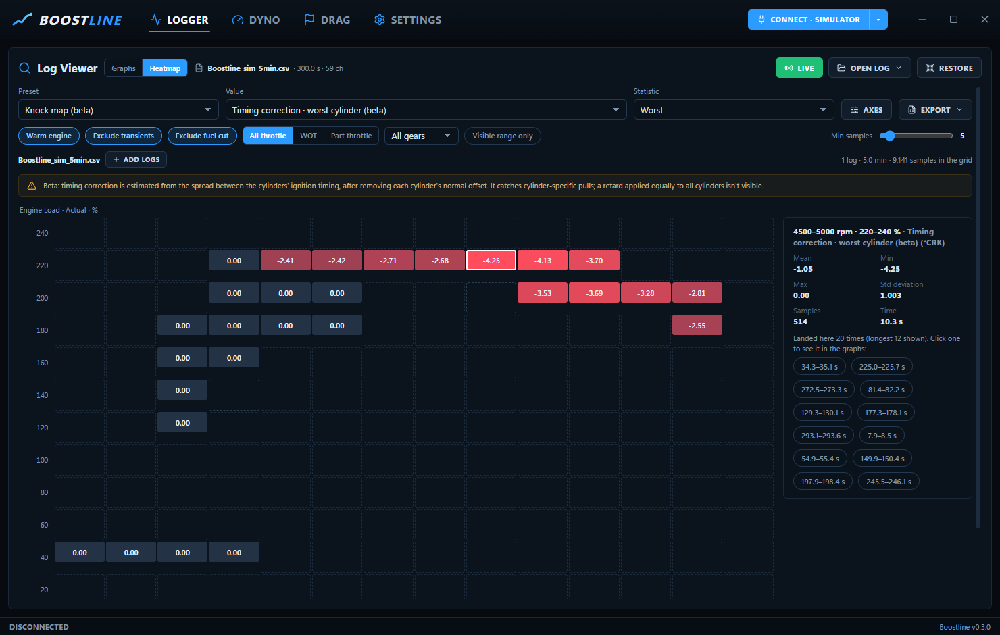

*The knock map on a 5-minute simulator log. Red cells show where timing was pulled. The panel on the right shows the selected cell's numbers and every moment that landed in it.*

### 1. Switch to the heatmap

Open a log in **Analyze** (pick it in the library, or use **Open**) and switch the toggle at the top left from **Graphs** to **Heatmap**. The controls are along the top:

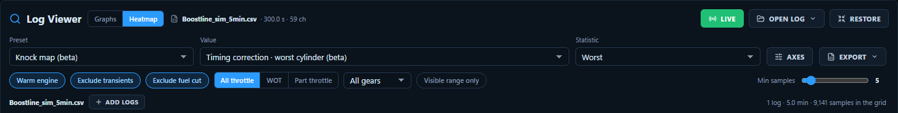

- **Top row:** the **Preset**, **Value** and **Statistic** pickers, plus **Axes** and **Export**.
- **Second row:** the filters and the minimum-samples slider.
- **Third row:** the logs in the grid. **Add logs** combines more of them.

### 2. Pick a preset

| Preset | Shows | Look for |
|---|---|---|
| **Knock map** (beta) | Worst-cylinder timing correction | Red cells: where timing gets pulled |
| **Lambda map** | Lambda actual − target | Red = leaner than requested, blue = richer |
| **Boost map** | Boost actual − target | Red = overboost, blue = under target (normal while spooling) |
| **Rail pressure map** | How far rail pressure drops below target, in % | Large drops: the high-pressure pump is at its limit |
| **Coverage** | Time spent in each cell | Which parts of the map your logs actually cover |

<table>
  <tr>
    <td>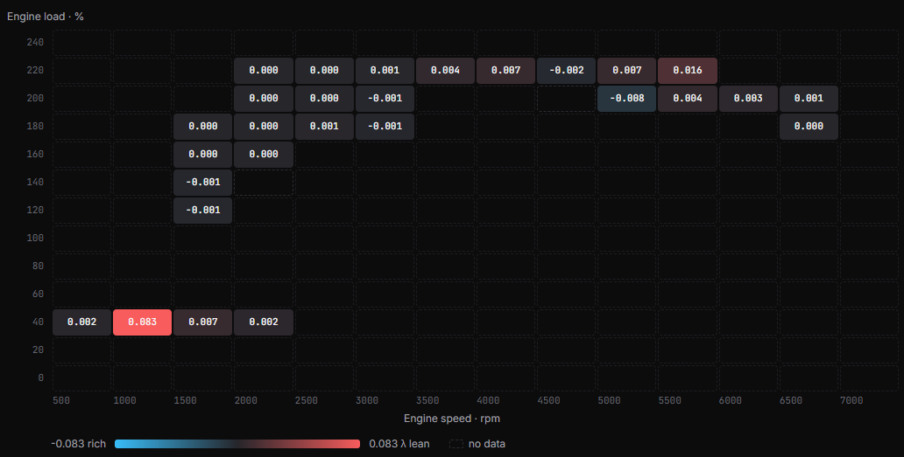</td>
    <td>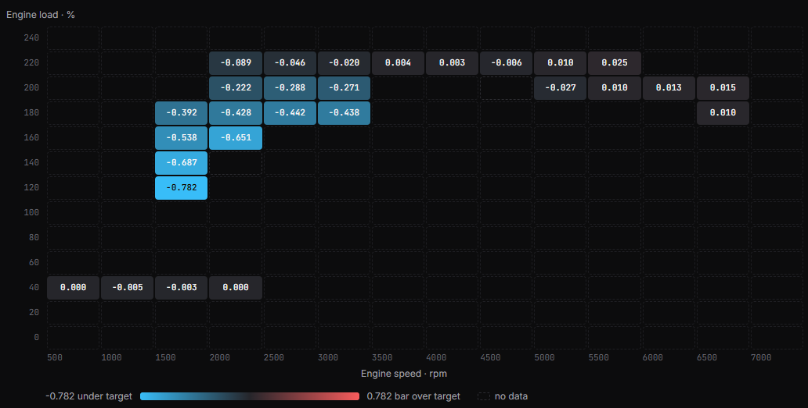</td>
    <td>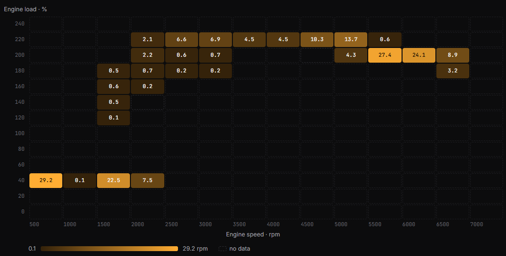</td>
  </tr>
  <tr>
    <td align="center"><b>Lambda map</b>: one lean cell where the engine comes out of fuel cut</td>
    <td align="center"><b>Boost map</b>: blue under target while the turbo spools at low RPM</td>
    <td align="center"><b>Coverage</b>: seconds spent per cell</td>
  </tr>
</table>

Diverging values like errors and corrections use **red for the bad direction and blue for the other**. Amounts like time or samples use a single amber scale. Dashed cells have no data, or fewer samples than the **Min samples** setting.

### 3. Click a cell, then jump to the graphs

Clicking a cell shows its mean, min, max, spread, sample count and time in the side panel, plus every moment in the logs that landed there (the longest twelve). Click a moment and Boostline switches back to **Graphs**, zoomed in on it with that stretch shaded blue, so you can see what the engine was doing:

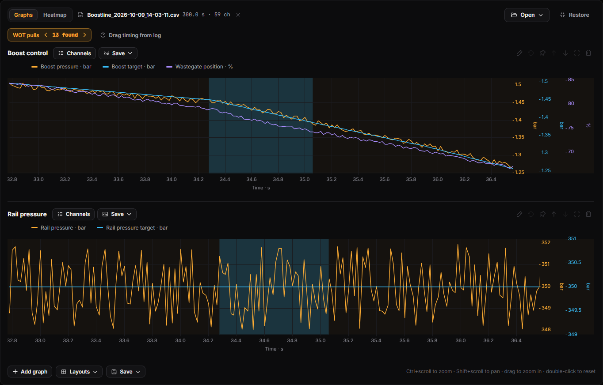

### Options

**Value and statistic.** Any channel works, not just the presets. Statistics are:
- *Mean*
- *Worst* (the bad direction for that value)
- *Min* and *Max*
- *Std deviation*
- *Samples* and *Time spent*

**Axes.** Columns default to engine speed (500–7,500 rpm in steps of 500) and rows to relative engine load (0–260 % in steps of 20).
- In **Axes** you can pick other channels (boost, MAF, torque…), set start, step and end, or use **Auto from data**.
- To line the grid up with a map in your tune, use the same breakpoints.
- If more than 10 % of the samples fall outside the axes, Boostline tells you to widen them.

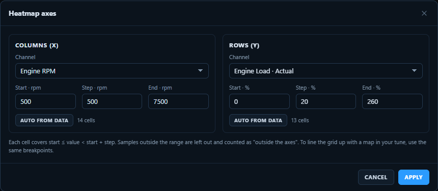

**Filters.**
- **Warm engine:** coolant at or above 80 °C.
- **Exclude transients:** skips sharp tip-ins, tip-outs and shifts. Normal boost build-up during a pull is kept.
- **Exclude fuel cut:** skips overrun with the pedal released.
- **All throttle / WOT / Part throttle.**
- **Gear.**
- **Visible range only:** uses the range you've zoomed to in the graphs.

**Min samples.** Cells with fewer samples are hidden, so a single stray sample can't paint a cell.

**Several logs.** **Add logs** combines more logs into the same grid, e.g. a week of driving. Cells are weighted by time, so logs recorded at different sample rates combine fairly. When several logs are combined, each moment in the side panel shows which log it came from.

### Export

**Export** offers three formats:
- **Copy table:** pastes into Excel or a map editor, highest load on top, like a tune table.
- **Save as CSV…**
- **Save as PNG…:** a shareable image with the title, source log, axes and legend.

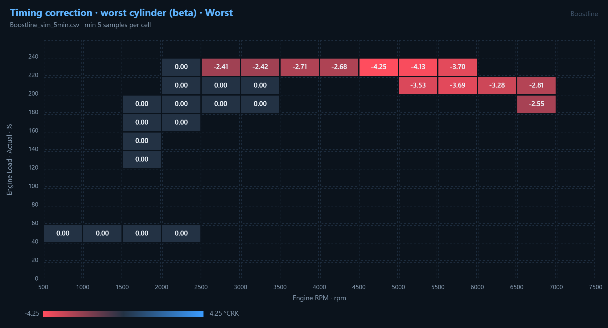

### About the knock map (beta)

BMW's DME data has per-cylinder ignition timing but no direct "timing correction" value, so Boostline estimates corrections:

1. It measures each cylinder's normal timing offset at part load, where knock control isn't active.
2. It removes that offset.
3. It reports how far each cylinder sits below the most-advanced cylinder.

This catches pulls on individual cylinders, which is how knock control usually acts. A retard applied equally to all cylinders isn't visible this way. Treat the knock map as a guide until it has been checked against more real-car logs.

---

## Setting up BMW DME data

Without this data, a real car only shows the generic OBD-II channels. Import it once on each PC to get boost target, wastegate, rail pressure, lambda target, per-cylinder timing and knock, VANOS and hundreds more. You need an internet connection for the download, but the car doesn't need to be connected.

### 1. Open Settings → BMW DME data

Click **Settings** at the bottom of the left-hand rail. The **BMW DME data** card is right below **Connection**.

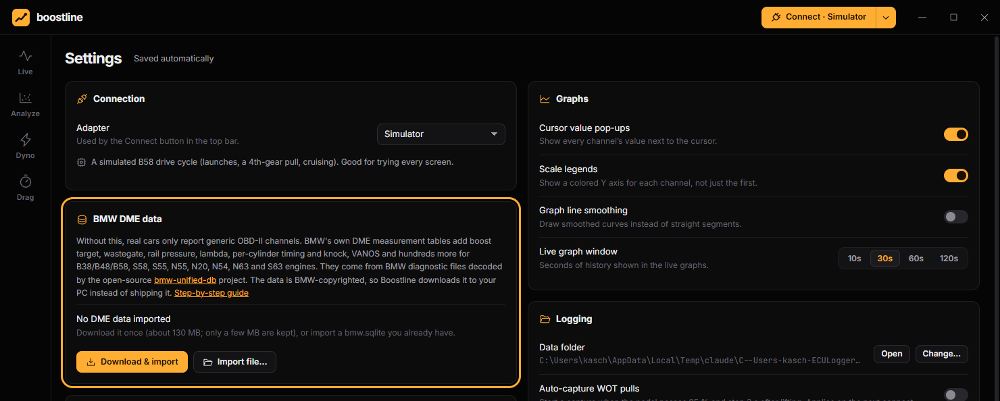

### 2. Click Download & import

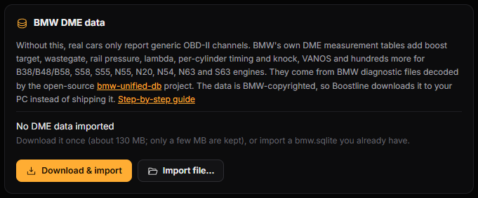

Boostline then:

1. Downloads the latest release of [bmw-unified-db](https://github.com/gediz/bmw-unified-db) from GitHub (about 130 MB).
2. Checks it against the release's SHA256 checksum.
3. Unpacks it and keeps only the engine-computer (DME) tables, about 3 MB.
4. Deletes the temporary files.

### 3. Wait for it to finish

Progress appears next to the buttons: *Downloading…*, *Verifying checksum…*, *Unpacking…*, *Extracting DME tables…*. On a normal connection it takes under a minute.

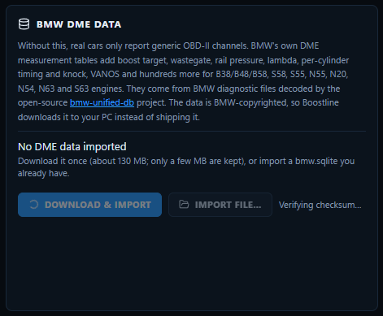

### 4. Check the result

When the import finishes, the card shows **Imported data** with the source version, the date, and how many engine ECUs and measurements were imported. Click **Show list** to see what's covered:

- **DME data:** the name of BMW's data file for that engine computer.
- **Engines / Chassis:** where that file is used.
- **Channels:** how many measurements it provides.
- **Auto:** *yes* means Boostline can recognize it automatically when you connect. *manual* means you have to choose it yourself (see step 5).

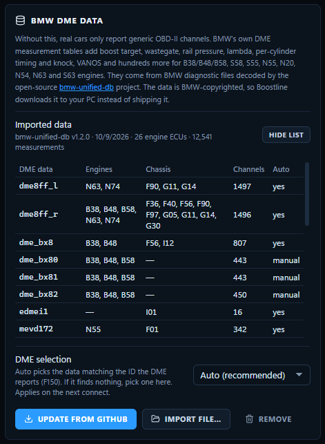

### 5. Leave DME selection on Auto, unless your car needs a manual choice

With **Auto (recommended)**, Boostline asks the DME to identify itself when you connect (`22 F150`, the same request BMW's own tools use) and picks the matching data.

Choose an entry manually in the **DME selection** dropdown when:

- **Your car has a 2016–2019 F-series B58** (gen 1: 340i, 440i, M240i, M140i, 540i). BMW's files for that DME (`dme_bx80`, `dme_bx81`, `dme_bx82`) carry no ID to match.
  - Pick the one for your car's integration level (I-level), which E-Sys, ISTA or BimmerCode can show you: `dme_bx80` is I-410, `dme_bx81` is I-411, `dme_bx82` is I-420.
  - If you don't know your I-level, start with `dme_bx82`. If many channels show "—", try the others.
- **The card says "(no match)" after you connect.** Choose the entry for your engine. Please also [open an issue](https://github.com/clucraft/Boostline/issues) with the ID it reported, so auto-detect can learn it.

Changes take effect the next time you connect.

### 6. Connect and check

Connect as usual. When the data is in use:

- **Top bar:** click the VIN next to the connection status. The menu shows **DME data**, e.g. `dme8ff_r`.
- **Settings:** the BMW DME data card shows the ID your DME reported and which data it matched.
- **Channel picker (Ctrl+K):** BMW channels appear with English names, such as *Boost target*, *Wastegate position*, *Rail pressure target* and *Ignition timing cyl 1–6*.
- **DME group:** a new **DME** group holds every other measurement, under BMW's original (German) names. Search the picker to find them.

### Updating, offline PCs and removing

- **Update from GitHub:** re-imports the newest bmw-unified-db release. Do this now and then; the project keeps improving.
- **Import file…:** for a PC without internet. On another computer, download `bmw.sqlite.gz` from the [bmw-unified-db releases](https://github.com/gediz/bmw-unified-db/releases), copy it over, and choose it here. Both `.sqlite` and `.sqlite.gz` work.
- **Remove:** deletes the imported data. Boostline goes back to the standard OBD-II channels.
- **Storage:** the data is kept in `%APPDATA%\Boostline\bmw-dme-data.json` on Windows and `~/Library/Application Support/Boostline/bmw-dme-data.json` on macOS.

### Troubleshooting

| Problem | What to do |
|---|---|
| Download fails | A firewall or proxy may be blocking GitHub. Use **Import file…** with a manually downloaded `bmw.sqlite.gz`. |
| "(no match)" after connecting | Choose the DME data manually (step 5) and report the ID in an issue. |
| Some channels show "—" | The DME didn't answer for that measurement. Run **Settings → Connection → Run diagnostics** and attach the report and a log to an issue. |

---

## Custom channel definitions

BMW-specific channels are added with JSON files in `Documents/Boostline/Definitions`. Each file is one definition set. A set applies when its `match.softwareVersions` patterns (case-insensitive regular expressions) match the DME's software identification, for example `SWFL_00002A6F_005_100_010` as read from the SVK. With no `match`, a set applies to every ECU.

```jsonc
{
  "name": "B58 TU · boost & knock",
  "match": { "softwareVersions": ["SWFL_00002A6F_"] },
  "ecuAddress": "0x12",                 // DME (0x13 = second DME on N63/S63)
  "channels": [
    {
      "id": "boost.target",             // reusing a built-in id replaces that channel
      "name": "Boost target",
      "group": "Boost",
      "unit": "bar",
      "quantity": "pressure",
      "decimals": 3,
      "source": {
        "type": "did",                  // UDS ReadDataByIdentifier
        "did": "0x1234",                // placeholder: use the real DID for your DME
        "offset": 0, "length": 2,       // bytes inside the DID record
        "signed": false, "endian": "big",
        "scale": 0.001, "add": -1.013   // value = raw × scale + add
      }
    },
    {
      "id": "knock.cyl1",
      "name": "Knock retard cyl 1",
      "group": "Knock",
      "unit": "°CRK",
      "quantity": "angle",
      "decimals": 2,
      "source": {
        "type": "memory",               // ECU RAM, read through a dynamic DID (2C 02) or 0x23
        "address": "0x00000000",        // placeholder: use the real address for your software
        "size": 2, "signed": true, "endian": "little",
        "scale": 0.0234375
      }
    }
  ]
}
```

The full format, including floats, `didLength` for batching and all defaults, is documented at the top of [`src/main/vehicle/definitions.ts`](src/main/vehicle/definitions.ts). Invalid files are skipped and reported in the log; they never block a connection. The DIDs and addresses above are placeholders, not real values.

---

## Log format

Boostline writes plain CSV that opens in Excel and other log viewers. It starts with a few `#` metadata lines:

```text
# app=Boostline
# started=2026-10-09T14:03:11.204Z
# adapter=ENET · 169.254.12.7
# vin=WBA...
# ids=engine.rpm,vehicle.speed,throttle.pedal,boost.actual
Time [s],Engine speed [rpm],Vehicle speed [km/h],Accelerator pedal [%],Boost pressure [bar]
0.000,2014,61.2,100.0,0.912
0.020,2031,61.4,100.0,0.948
```

---

## How the road dyno works

For each sample in the pull, Boostline:

1. Smooths vehicle speed and differentiates it to get acceleration *a*. It uses a local linear-regression slope, which tolerates irregular sampling.
2. Computes the force at the wheels: **F = m·a + ½·ρ·Cd·A·v² + Crr·m·g**. Air density ρ comes from temperature, pressure and humidity.
3. Calculates wheel power as **P = F·v** and engine power as **P / (1 − drivetrain loss)**. Optionally applies SAE J1349 or DIN 70020 correction.
4. Derives torque as **T = P_engine / ω**, with ω = 2π·rpm/60. Results are binned by RPM.

The numbers are estimates: they're only as good as the mass, loss and aero inputs, and the road needs to be flat.

---

## Project structure

```text
src/
  main/              Electron main process
    vehicle/         Adapters: simulator, HSFZ/ENET, UDS client, OBD channels, discovery, diagnostics
    session.ts       Connection lifecycle, streaming, batching to the UI, recording
  preload/           Typed, sandboxed bridge (window.boostline)
  renderer/          React UI: Live, Analyze, Dyno, Drag, Settings (uPlot charts, Phosphor icons)
  shared/            Types, units, channel catalog and the pure analysis code
    analysis/        CSV, WOT detection, gear detection, air density, dyno, drag
test/                Vitest suites, including a fake BMW gateway for protocol tests
```

## Contributing

Issues and pull requests are welcome. Especially helpful:

- Connection diagnostics reports from MHD / bootmod3 adapters
- Channel definition files for specific DME software versions
- Logs from other tools that don't import cleanly

Before opening a PR, run `npm run typecheck` and `npm test`.

## License

[MIT](LICENSE) © Boostline contributors
